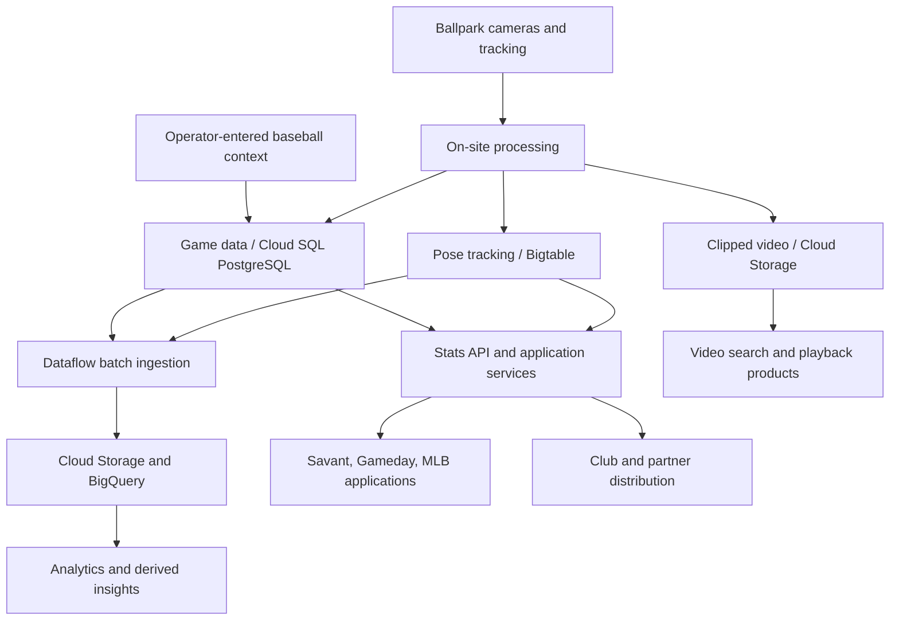

# MLB data storage and distribution

Research reviewed **2026-11-09**. This is a synthesis of MLB engineering articles and first-party Google Cloud accounts. Publication dates describe the architecture at that time; they do not establish MLB's exact production configuration today. Endpoint response checks belong in the endpoint catalogs and discovery notes.

## The layers to distinguish

MLB separates captured tracking data, baseball event context, derived metrics, analytical copies and video assets. A public Savant export is a product representation of some of this data, not a description of the underlying database schema. The following diagram combines dated accounts; it is a conceptual flow rather than a current deployment inventory. [1][2][3]

The Bigtable-to-API and application-service grouping abstracts the 2022 description of live and historical data distribution; it does not imply that a public API offers unrestricted Bigtable queries. The media branch does not assert a public Google Cloud Storage bucket. [1][2]

## What the primary sources establish

| Source date | Findings | Research consequence |
| --- | --- | --- |
| July 20, 2020 | Hawk-Eye data goes to PostgreSQL in Google Cloud and is distributed through Stats API. Clipped video feeds are saved in Cloud Storage for video search. The installation described uses five 100 FPS pitch cameras and seven 50 FPS player/ball cameras. [1] | Search structured events and media metadata separately. These historical camera specifications should not be generalized to every season. |
| 2020 | Dataflow ingests historical and new event-level Stats API data into BigQuery tables. Schedules, rosters and probable starters supplement pitch/event records; Composer orchestrates the game-note pipeline. [3] | A warehouse can contain API-derived copies plus supporting tables. Its presence does not imply public SQL access. |
| April 7, 2022 | On-site processing uses Anthos/GKE. Human operators tag baseball context. Pose data is stored in Bigtable and other game data in Cloud SQL PostgreSQL. Nightly Dataflow jobs move data to Cloud Storage and BigQuery. [2] | High-frequency pose records and relational events have distinct storage needs. CSV rows cannot be assumed to preserve the original time series. |
| June 13, 2024 | MLB's VP of Software Engineering describes near-real-time APIs serving MLB products and partners, and Statcast data reaching BigQuery environments for clubs. [4] | This supports continued API and analytical distribution through 2024, without reconfirming every component of the 2022 database layout. |

These are compatible descriptions at different levels of detail, not proof that the underlying system never changed. In particular, “stored in Google Cloud” does not identify an externally addressable bucket, database, account or table. [1][2][4]

## What the engineering blog adds about the data

**Measurements and classifications are different.** In February 2020, MLB described pitcher-specific neural networks classifying pitches from measured properties, with training and repertoire maintenance. Labels are an inference layer rather than another camera measurement; the article also discusses classification errors and recalibration. This matters when comparing a saved live feed with a later export. The article establishes mutable classification machinery, not a guarantee of when each public endpoint is corrected. [5]

**Expected outcomes are model outputs.** The September 2019 xwOBA article describes models based on exit velocity, launch angle and, for selected contact, runner speed. It discusses model evolution and intentionally omitted context. An expected outcome field is not the actual result of the play and does not expose the whole training dataset or model. Those 2019 implementation details must be dated when used to interpret modern fields. [6]

**Aggregated fielding metrics require richer underlying data.** The January 2020 infield OAA article describes actual fielder positions, distance/time relationships, an intercept point, throws and runner arrival estimates. A leaderboard result therefore does not imply that the complete positional trajectories used to calculate it are publicly downloadable. [7]

These three additional engineering articles explain the semantics and processing of data, but do **not** publish additional API route specifications. Do not turn a metric name in a blog post into an invented endpoint. [5][6][7]

## Video discovery and identifier relationships

The original article's strongest endpoint lead is its link to MLB's advanced video search. It establishes a connection between tracking/event metadata and separately stored clips, not a direct bucket API. MLB's public video surfaces include [Film Room](https://www.mlb.com/video) and the [Savant video viewer](https://baseballsavant.mlb.com/sporty-videos). These are HTML applications; their URLs should not be classified as JSON data endpoints solely because they return HTTP 200. [1][8][9]

For discovery, follow a real game/event identifier from a structured response into the corresponding viewer or content response. Inspect metadata for playback URLs, content IDs and event associations. A game identifier, a pitch/play identifier, an editorial clip identifier and a media asset URL represent different entities; prove a mapping from returned metadata rather than assuming they are interchangeable. This is a discovery method, not a claim about MLB's private relational schema.

Observed in the **2026-11-09** endpoint checks: game `716463` exposes public feed and content JSON. A feed `playEvents[].playId` value, `fced30ac-7099-4337-a52f-9bc983932b31`, resolves through the Savant viewer to an HTML video source on `sporty-clips.mlb.com`. The game's content response includes `highlights.highlights.items[].playbacks` with MP4/HLS entries, while highlight IDs can be slugs rather than pitch UUIDs. See [endpoint research evidence](ENDPOINT_RESEARCH.md) for requests and observed response details.

Media metadata and media bytes require separate checks. A JSON response containing playback URLs is evidence of metadata access; a playable MP4 or manifest is separate evidence of media availability. Availability of an edited highlight does not establish access to every pitch, camera angle, raw Hawk-Eye recording or full broadcast. The catalog should preserve whether a route is a viewer, JSON metadata endpoint, CSV export, manifest or media file.

## Public access, privileged distribution and unresolved questions

- The primary sources discuss distributions to clubs and partners as well as consumer products. They do not establish equal public access to every Statcast dataset or every API resource. [1][2][4]
- A game/play analytics request for the verified game and play, with `hydrate=analytics(hit,pitch,ball,metrics,video,positions,diagram)`, returned **401 / Okta login** in this review. Its response schema remains unverified. A historical Swagger route redirected to the new documentation site and returned **200 HTML documentation shell**, rather than the requested JSON specification. These checks establish access boundaries for those requests, not the contents of the restricted data. [Endpoint evidence](ENDPOINT_RESEARCH.md).
- PostgreSQL, Bigtable, BigQuery and Cloud Storage are implementation components in dated accounts. None of the cited architecture articles grants public database access or identifies a public raw-data bucket. [1][2][3]
- An anonymous request that succeeds establishes that response's accessibility at the check time. It does not establish a stable API contract, permission to redistribute footage, or a universal absence of authentication requirements.
- Missing or empty payloads do not by themselves distinguish unavailable tracking, absent media, wrong identifiers, historical coverage gaps or restricted access. Record HTTP status and response shape alongside the specific identifiers used.
- Still unknown: current internal schemas, retention policies, complete event-to-video synchronization/timing guarantees, completeness of public pose/trajectory exposure, and how corrections propagate between live feeds, warehouse copies and Savant exports. The reviewed articles do not resolve these questions.

## What the expanded API audit reveals about representation

The [published OpenAPI snapshot](statsapi_openapi.json), extracted from a first-party documentation asset during the expanded audit, describes much richer representations than the initial CSV reference. See [the Stats API audit](STATSAPI_AUDIT.md) for source provenance and access results. These are **documented response schemas**, not direct observations of private storage tables or a guarantee that anonymous clients can retrieve their contents.

| Documented interface | Representation and implication |
| --- | --- |
| `AnalyticsPlayMetadataRestObject` | Identifies games and GUIDs, at-bat/pitch/pickoff numbers, timecodes, event times and file references (`analyticsFile`, `rawFile`, `parsedFile`). It separately tracks `updatedAt`, `auditUpdatedAt`, `metricsUpdatedAt` and `videoUpdatedAt`. Consumers can distinguish types of correction in the interface; backend transaction/storage behavior remains unknown. |
| `/api/v1/analytics/guids` and `/api/v1/analytics/game` | Document filters for play, general-update, metrics, audit and video timestamps. This is an incremental-discovery interface rather than a bulk database export. |
| `AnalyticsRestObject` | Groups ball segments, tracked events, target positions, calculated/context metrics, video, calibration, bat and weather representations. A public pitch CSV is only one projection of this richer documented model. |
| Skeletal files and chunked routes | `/analytics/skeletalData/files` returns a documented filename list; `/analytics/skeletalData/chunked` requires a `fileName` query parameter. This shows a file/chunk retrieval interface, without establishing a public bucket, file naming policy, compression format or anonymous access. |
| `BatTrackingRestObject` | Separates `gamePk`, per-game `playId`, impact, sweet spot, bat-position arrays, measurement time and tracking-system metadata. Aggregate bat-speed statistics do not expose all these records. |

The [expanded media audit](MEDIA_AUDIT.md) verifies another event-to-video join: Data Graph's `getGamesByGamePks` returns clip records with `playGuid`/`playIdRef` and `playbackScenarios`. For game `716463`, 16 returned `playGuid` values matched Stats API play IDs. This is evidence of an identifier relationship for those clips, without establishing complete pitch coverage or exact time synchronization.

The current [Gameday application audit](GAMEDAY_AUDIT.md) also demonstrates application aggregation services: BDFed supplies game-content and categorized play metrics, while a separate Scout service serves insights and briefings. Both Scout probes required authentication. These observed service boundaries supplement the dated cloud architecture; they do not reveal how those services persist their records.

The public [Fastball GraphQL schema snapshot](mlb_fastball_schema.json) further describes Film Room's media/search interfaces: 26 query fields, two mutation fields and 107 types. Those are fields on GraphQL roots, not 28 distinct HTTP paths or a database schema. [The media audit](MEDIA_AUDIT.md) separates this server schema from client query names, local cache operations, live results and Data Graph's disabled introspection.

## Sources

1. Ben Jedlovec, MLB Technology Blog, **July 20, 2020**, [Introducing Statcast 2020: Hawk-Eye and Google Cloud](https://technology.mlblogs.com/introducing-statcast-2020-hawk-eye-and-google-cloud-a5f5c20321b8). Read the system overview and distribution sections; the future-development section describes plans, not confirmed delivery at publication.
2. Priyanka Vergadia, with MLB Rob Engel, Google Cloud, **April 7, 2022**, [Teaming up with MLB for game-changing sports analytics](https://cloud.google.com/blog/products/data-analytics/mlb-pitches-new-data-uses-with-google-cloud-services). Most explicit operational storage split found in the reviewed sources.
3. Google Cloud, **2020**, [How MLB is using data analytics on Google Cloud to tell better stories with their data](https://cloud.google.com/blog/products/data-analytics/how-mlb-is-using-data-analytics-on-google-cloud). Ingestion and analytical game-note pipeline. Search-indexed first-party article contents were accessible during this review; direct page fetching timed out.
4. Rob Engel, MLB VP of Software Engineering, Google Cloud, **June 13, 2024**, [AI at Bat: How Major League Baseball is surfacing stats faster with AI](https://cloud.google.com/transform/mlb-statcast-ai-fan-experience-team-analytics).
5. Cory Schwartz and Sam Sharpe, MLB Technology Blog, **February 3, 2020**, [MLB Pitch Classification](https://technology.mlblogs.com/mlb-pitch-classification-64a1e32ee079).
6. Sam Sharpe, MLB Technology Blog, **September 21, 2019**, [An Introduction to Expected Weighted On-Base Average (xwOBA)](https://technology.mlblogs.com/an-introduction-to-expected-weighted-on-base-average-xwoba-29d6070ba52b).
7. Tom Tango, MLB Technology Blog, **January 13, 2020**, [Introducing Infield Outs Above Average](https://technology.mlblogs.com/introducing-infield-outs-above-average-6467e61a98dc).
8. MLB, [Film Room / video search](https://www.mlb.com/video), public application reviewed during research.
9. Baseball Savant, [Savant video viewer](https://baseballsavant.mlb.com/sporty-videos), public application reviewed during research.
