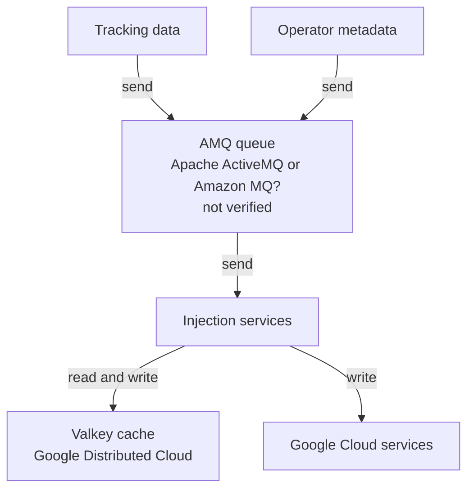
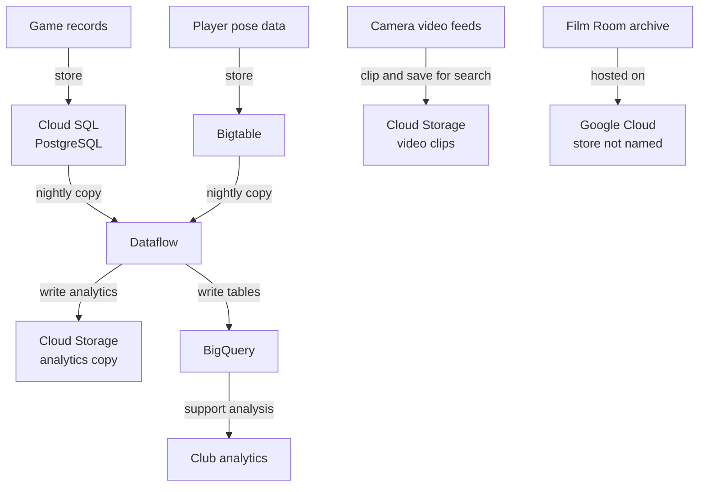
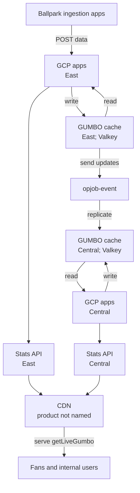
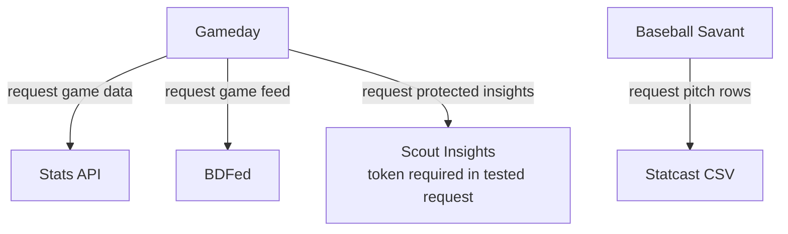
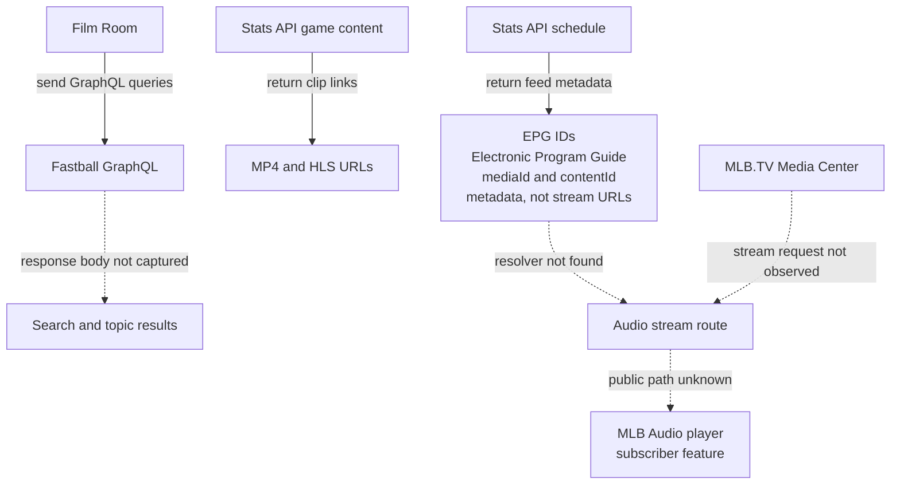

# MLB data systems and endpoint catalog

This repository maps public Baseball Savant, MLB Stats API, Gameday, and MLB video interfaces, and summarizes what first-party sources say about MLB's data systems.

For endpoint inventories, start with [AGENTS.md](AGENTS.md). The route catalogs and Stats API OpenAPI file are in [api-routes](api-routes/). Formal schemas and observed response views are in [schemas](schemas/README.md). The catalogs distinguish documented endpoints, source-discovered routes, directly observed responses, and access that remains unknown. The [public data evidence note](MLB_PUBLIC_DATA_EVIDENCE.md) records a bounded REA/browser investigation and response hashes from November 10, 2026.

## How MLB's data moves

The diagrams below combine dated MLB/Google Cloud reports with public observations. They show reported roles, not a live deployment map. Labels use [ASD-STE100](https://www.asd-ste100.org/) principles: short terms, clear actions, and separate known and unknown links. MLB product names remain unchanged. Solid arrows show a flow that a source describes. Dotted arrows show a link that remains uncertain. The sources do not expose private schemas, bucket names, or unrestricted storage access. [Sources 1–6](#sources)

### Capture, storage, and distribution

MLB's 2025 article labels the queue `AMQ`, but does not expand the name or identify the product. The diagram lists Apache ActiveMQ and Amazon MQ as possible meanings. Neither is verified.

### Reported storage and analytics paths

MLB described these storage roles in 2020 and 2022. Its 2024 account says Statcast data reaches club BigQuery environments through APIs. The articles do not name retention rules, table layouts, or bucket paths. They do not say if video and analytics files use the same storage. [Sources 1–3](#sources)

The 2025 article describes three Valkey uses. At the ballpark, an AMQ queue sends tracking data and operator metadata to injection services. Those services read and write a local Valkey cache. They also write data to Google Cloud services. For live games, GUMBO is a JSON record of game state. Regional apps read and write GUMBO caches. The figure shows East GUMBO data passing through a component labeled `opjob-event` before it reaches Central GUMBO. The article does not describe that component's implementation or trigger. A CDN serves `getLiveGumbo`; the article does not name the CDN product. For other data, regular and heavy Valkey clusters use read-through caching. MLB names stats, rosters, standings, and schedules as cached data. These links are from the article's [ballpark figure](https://storage.googleapis.com/gweb-cloudblog-publish/images/1_3QpqGX2.max-800x800.png) and [GUMBO figure](https://storage.googleapis.com/gweb-cloudblog-publish/images/2_QNOyrE2.max-1600x1600.png). The GUMBO figure labels its caches "redis gumbo"; the article text names Memorystore for Valkey. The source does not state if the CDN in the figure is Google Media CDN. The API and clip paths below are separate public observations. [Sources 1–6](#sources)

### Live GUMBO and regional cache path

### Public services and what they expose

Gameday uses Stats API and BDFed services. The tested Scout route required a bearer token. Baseball Savant returned pitch rows from its CSV route.

On November 10, 2026, game content returned clip URLs. The schedule returned radio and TV EPG IDs. EPG means electronic program guide. These IDs are metadata, not stream URLs. The Film Room page capture observed five GraphQL operations with HTTP 200 responses. It did not start video playback or capture an MP4/HLS request. MLB Help says MLB Audio is a subscriber feature. The captures do not show a path to raw camera recordings, full broadcasts, or private databases. See the [evidence note](MLB_PUBLIC_DATA_EVIDENCE.md).

## How to interpret the architecture

- MLB's engineering sources describe different dates and levels of detail. The 2020–2022 articles describe the stores and data copies; MLB's 2025 account adds the Valkey caching layer. These reports do not prove that every component remains deployed exactly as described.
- A Savant export, Stats API response, GraphQL result, playback URL, and internal storage object are different representations. An identifier match in one observed game does not guarantee universal coverage or a complete event-to-video join.
- MLB's published player-tracking point counts differ across dates and descriptions. Do not treat the public pitch-level exports as the complete camera or pose stream.
- Publicly readable documentation or a schema does not mean every operation or underlying dataset is publicly accessible. Authentication and response outcomes are recorded per request in the inventories.
- Public sources identify no storage layout for the audio stream itself, no direct access to MLB's operational databases, and no public raw-camera bucket. The sampled HLS/MP4 resources are selected clips, not full broadcasts.
- Google Cloud's case study names Media CDN for live streaming; it does not establish that the observed highlight host uses that product.

## Sources

1. Ben Jedlovec, MLB Technology Blog, July 20, 2020, [Introducing Statcast 2020: Hawk-Eye and Google Cloud](https://technology.mlblogs.com/introducing-statcast-2020-hawk-eye-and-google-cloud-a5f5c20321b8). The camera, PostgreSQL, Stats API distribution, and clipped-video statements are historical descriptions from this article.
2. Priyanka Vergadia with MLB's Rob Engel, Google Cloud, April 7, 2022, [Teaming up with MLB for game-changing sports analytics](https://cloud.google.com/blog/products/data-analytics/mlb-pitches-new-data-uses-with-google-cloud-services). Describes stadium processing, manual context tagging, Cloud SQL, Bigtable, Dataflow, Cloud Storage, BigQuery, and product feeds.
3. Rob Engel, MLB VP of Software Engineering, Google Cloud, June 13, 2024, [AI at Bat: How Major League Baseball is surfacing stats faster with AI](https://cloud.google.com/transform/mlb-statcast-ai-fan-experience-team-analytics). Describes near-real-time APIs and distribution to MLB products, clubs, scoreboards, and broadcast partners.
4. Rahul Joshi, Principal Software Engineer, MLB, Google Cloud, August 4, 2025, [How MLB keeps fans connected to the game – one cache hit at a time](https://cloud.google.com/blog/products/databases/mlb-delivers-real-time-data-to-fans). Describes ballpark buffering, two-region GUMBO, and read-through caches. The article includes [a ballpark diagram](https://storage.googleapis.com/gweb-cloudblog-publish/images/1_3QpqGX2.max-800x800.png) and [a GUMBO diagram](https://storage.googleapis.com/gweb-cloudblog-publish/images/2_QNOyrE2.max-1600x1600.png).
5. Google Cloud, October 11, 2022, [Crackerjack data: How MLB is reinventing the fan experience](https://cloud.google.com/blog/transform/mlb-reinventing-fan-experience-with-cloud-today-tomorrow-even-yesterday). Reports that Film Room was hosted on Google Cloud, with over three million searchable video assets and automated clip generation; it does not name a specific serving bucket or media origin.

6. Google Cloud, [MLB case study](https://cloud.google.com/customers/major-league-baseball). Lists Media CDN among the products used in MLB's cloud portfolio and describes planned live-stream delivery; it does not identify the delivery service for the public clip host observed here.

MLB/MLBAM [terms of use](https://www.mlb.com/official-information/terms-of-use) apply. Repository observations are documentation, not a licensing determination or a guarantee of stable service behavior.
