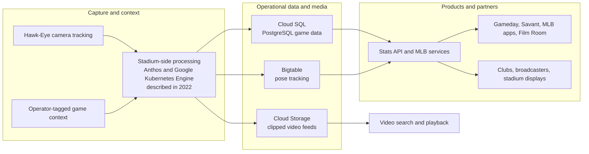
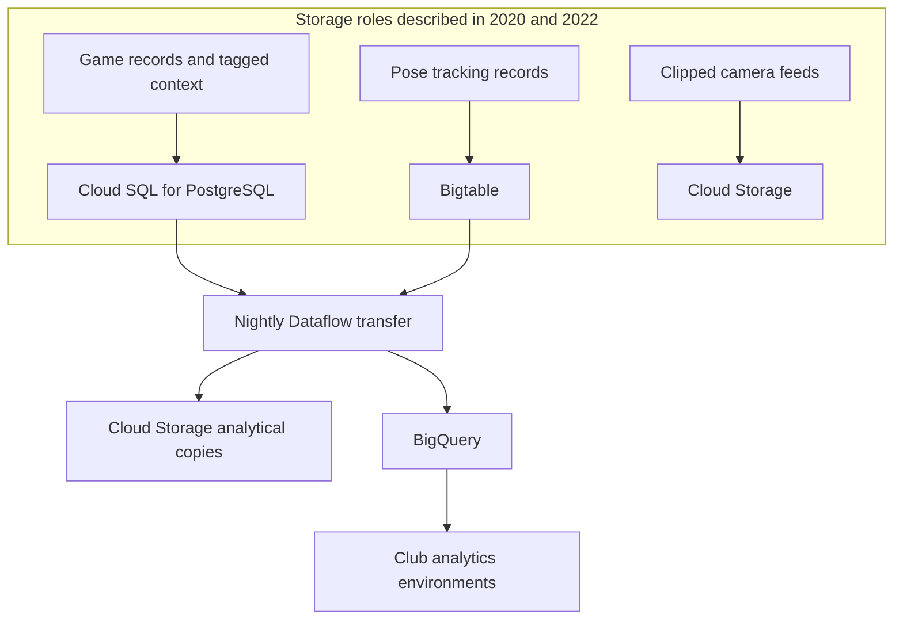
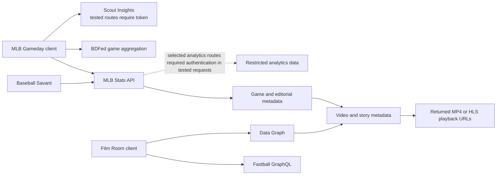

# MLB data systems and endpoint catalog

This repository maps public Baseball Savant, MLB Stats API, Gameday, and MLB video interfaces, and summarizes what first-party sources say about MLB's data systems.

For endpoint inventories and schemas, start with [AGENTS.md](AGENTS.md). The catalogs distinguish documented endpoints, source-discovered routes, directly observed responses, and access that remains unknown.

## How MLB's data moves

The diagrams below synthesize MLB and Google Cloud descriptions published in 2020, 2022, and 2024. They explain reported system roles; they are not a live deployment map. The articles do not expose MLB's private database schemas, bucket names, or unrestricted storage access. [Sources 1–3](#sources)

### Capture, storage, and distribution

The operational stores and stadium processing are drawn from the 2020 and 2022 accounts. The 2024 account confirms the broader API-to-products-and-partners distribution pattern, but does not reconfirm the exact 2022 storage topology. Arrows summarize published descriptions; they do not assert that a public API directly queries Bigtable or that video playback is served from Cloud Storage. [Sources 1–3](#sources)

### Storage and analytical copies

The 2020 article says clipped video feeds were saved in Cloud Storage for search. The 2022 article describes Cloud SQL for game data, Bigtable for pose tracking, and nightly Dataflow movement into Cloud Storage and BigQuery. Neither establishes current retention, table layouts, bucket paths, or whether analytical and video objects share storage. MLB's 2024 account separately describes Statcast data reaching club BigQuery environments through APIs. [Sources 1–3](#sources)

### Public services and what they expose

This diagram combines repository observations with the dated distribution accounts. Gameday uses both Stats API and BDFed services; tested Scout routes required a bearer token. The endpoint observations are mainly from November 9, 2026. The diagram distinguishes event metadata from playback resources: tested public routes returned selected clip URLs, while tested detailed tracking routes required authentication. These observations apply to the requests and dates recorded in the [endpoint catalogs](AGENTS.md); they do not imply access to raw camera recordings, full broadcasts, or private databases.

## How to interpret the architecture

- MLB's engineering sources describe different dates and levels of detail. The 2020 camera, PostgreSQL, and clipped-video account; the 2022 storage and processing account; and the 2024 API distribution account are compatible, but do not prove that every component remains deployed as described.
- A Savant export, Stats API response, GraphQL result, playback URL, and internal storage object are different representations. An identifier match in one observed game does not guarantee universal coverage or a complete event-to-video join.
- Publicly readable documentation or a schema does not mean every operation or underlying dataset is publicly accessible. Authentication and response outcomes are recorded per request in the inventories.
- Nothing in the reviewed sources establishes a public raw-data bucket, direct database access, complete pose export, or anonymous full-game stream.

## Sources

1. Ben Jedlovec, MLB Technology Blog, July 20, 2020, [Introducing Statcast 2020: Hawk-Eye and Google Cloud](https://technology.mlblogs.com/introducing-statcast-2020-hawk-eye-and-google-cloud-a5f5c20321b8). The camera, PostgreSQL, Stats API distribution, and clipped-video statements are historical descriptions from this article.
2. Priyanka Vergadia with MLB's Rob Engel, Google Cloud, April 7, 2022, [Teaming up with MLB for game-changing sports analytics](https://cloud.google.com/blog/products/data-analytics/mlb-pitches-new-data-uses-with-google-cloud-services). Describes stadium processing, manual context tagging, Cloud SQL, Bigtable, Dataflow, Cloud Storage, BigQuery, and product feeds.
3. Rob Engel, MLB VP of Software Engineering, Google Cloud, June 13, 2024, [AI at Bat: How Major League Baseball is surfacing stats faster with AI](https://cloud.google.com/transform/mlb-statcast-ai-fan-experience-team-analytics). Describes near-real-time APIs and distribution to MLB products, clubs, scoreboards, and broadcast partners.

MLB/MLBAM [terms of use](https://www.mlb.com/official-information/terms-of-use) apply. Repository observations are documentation, not a licensing determination or a guarantee of stable service behavior.
